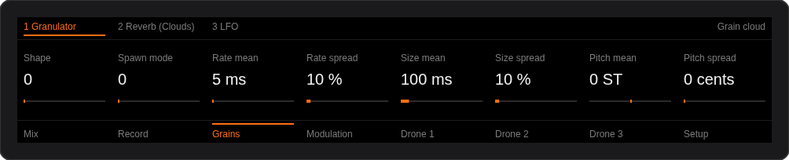
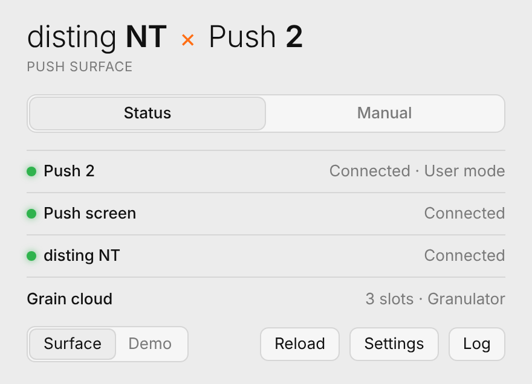
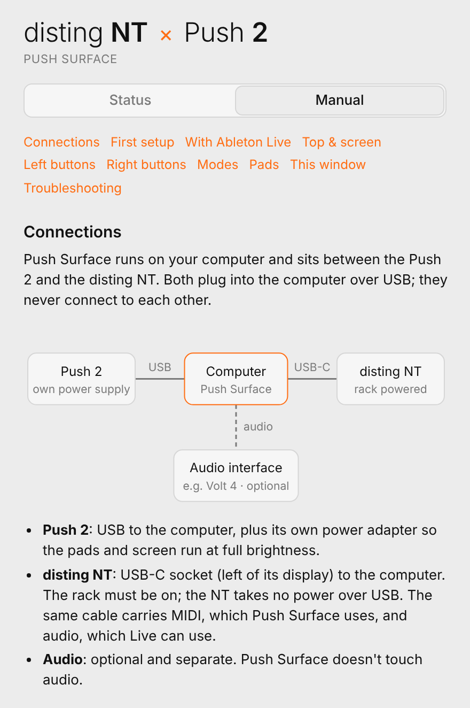
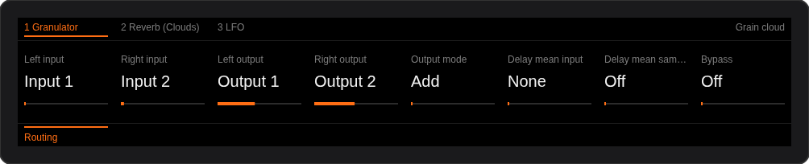
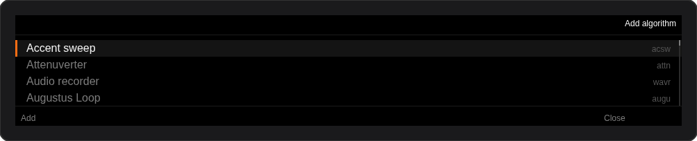
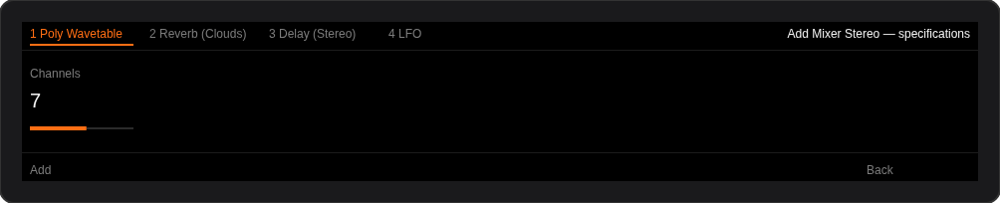
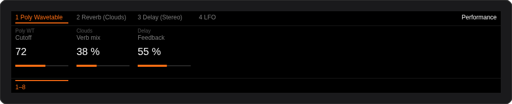
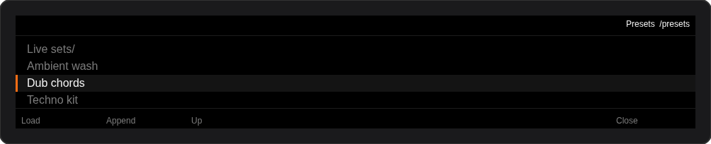
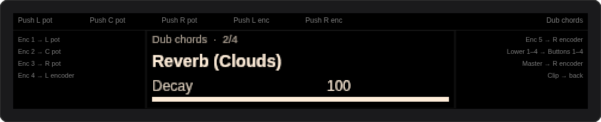

# Push Surface

**Play and edit an Expert Sleepers disting NT from an Ableton Push 2.** Free, for Mac and Windows.

Push Surface is a small app that sits between the Push 2 and the disting NT. The Push's screen, encoders, buttons and pads become a full editor for the module: every slot, parameter page, parameter and menu value, the whole algorithm library, presets on the SD card, mappings and the performance page. Ableton Live is not needed, and it can run alongside Live.



## Download

Get the latest version from the [**Releases**](../../releases/latest) page:

| | File | Needs |
|---|---|---|
| **Mac** (Apple Silicon) | `Push-Surface.dmg` (about 14 MB) | macOS 12 or later, and [Node.js](https://nodejs.org) 20 or later (`brew install node`) |
| **Windows** (64-bit) | `Push-Surface-Windows-x64.zip` (about 200 MB) | Windows 10 or 11. Nothing else; it brings its own runtime |

No disting NT on hand? Switch the app to **Demo**: it simulates a disting NT with all 88 algorithms, so you can try every Push control.

## Screenshots

<p>


</p>

The app window shows whether the Push 2, the Push screen and the disting NT are connected, along with the current preset. A **Manual** tab explains every button and the setup.

What the Push screen shows:

| | |
|---|---|
|  | **Device**: the slot's parameters, laid out in the NT's own pages. Here the Granulator's stereo routing |
|  | **Add Device**: the NT's algorithm library |
|  | then its specifications (channels, voices…) before adding it |
|  | **Mix**: the NT's performance page |
|  | **Browse**: presets on the SD card |
|  | **Clip**: the NT's own screen mirrored, with Push controls acting as its pots, encoders and buttons |

## Setup

1. **Connect.** Plug the Push 2 into the computer over USB, with its power supply attached. Plug the disting NT's USB-C socket into the computer too, with the rack switched on. The Push and the NT never connect to each other directly.
2. **Install.**
   - **Mac:** open the DMG and drag *Push Surface* onto *Applications*. The first time you open it, macOS says it can't verify the app, because it isn't notarised. Click **Done**, then go to **System Settings → Privacy & Security**, scroll down, and click **Open Anyway**. You only do this once.
   - **Windows:** unzip, keep the *Push Surface* folder together, and run **Push Surface.exe**. If SmartScreen says it protected your PC (the app isn't code-signed), click **More info → Run anyway**.
3. **Open Push Surface.** The three lights go green, the Push switches to User mode, and its screen shows the NT's current preset.

On the NT, *Settings → SysEx Device ID* must match `sysExId` in the app's Settings (0 by default).

**Push screen on Windows:** the screen is driven over USB, so it needs a USB driver. Installing Ableton Live puts one in place. Without Live, use [Zadig](https://zadig.akeo.ie) to install **WinUSB** for *Ableton Push 2 (Interface 0)*.

### With Ableton Live running

When Live sees the Push it takes it over: the pads switch to Live and the screen goes back to Live's. To use both at once, keep Live off the Push:

1. In Live, open **Settings → Link, Tempo & MIDI**.
2. In the Control Surface list, set **Push2** to **None**, with Input and Output set to *None*.
3. Under MIDI Ports, turn **Track** and **Remote** off for the Push 2 ports.
4. Press **Reload** in Push Surface. It takes the Push back.

The NT can still be Live's audio interface over the same USB cable, because Push Surface only uses its MIDI. On Windows, close Live while you change these settings: Windows lets only one app open a MIDI port at a time.

## Using it

Press a mode button to enter a mode, and press it again (or **Device**) to go back.

| Button | Mode |
|---|---|
| **Device** | edit the selected slot's parameters (the default) |
| **Add Device** | add an algorithm: library → specifications → Add |
| **Browse** | presets on the SD card: Load, Append, folders |
| **Mix** | the NT's performance page |
| **Automate** | CV / MIDI / I2C mapping for the last parameter touched |
| **Clip** | the NT's front panel on the Push; reaches every menu on the module |
| **Setup** | CPU load per slot, Reload |
| **Scale** | pad root, scale, in-key layout, velocity, MIDI channel |

| Push 2 | Does |
|---|---|
| 8 buttons above the screen | select slot 1–8 (◀ ▶ for more; Shift + ◀ ▶ moves the slot) |
| 8 buttons below the screen | select the NT's parameter page |
| 8 encoders | the parameters shown (Shift = fine; Delete + touch = reset to default) |
| **Undo** / Shift + Undo | undo / redo parameter changes |
| **Duplicate** | duplicate the slot with its settings |
| Delete + slot button | remove that slot |
| **Mute** / **Solo** | bypass the slot / bypass every other slot |
| **New** / **Record** | new preset / save the preset to the SD card |
| **Note** | pads play the NT, with velocity, poly aftertouch and pitch bend |
| **Session** | pads become a grid of slots × pages |

The app's **Manual** tab has the complete reference for every button.

## How it works

```
 Push 2 ──USB MIDI (User port)──┐                       ┌──USB MIDI SysEx── disting NT
         ──USB bulk (screen)────┤   Push Surface engine ├
                                └─ controller · render ─┘
```

- **The disting NT** is controlled entirely over MIDI SysEx on its USB port (`F0 00 21 27 6D <id> …`). On connecting, the engine reads the preset: slot list, algorithm names, the NT's own parameter pages, and for each parameter its name, range, unit, default and menu strings. After that it polls current values a few times a second, so turning a knob on the module shows up on the Push. Edits go back as *set parameter* messages. The same protocol covers the algorithm library, adding, removing, moving and renaming slots, presets on the SD card, mappings and the performance page. For **Clip** mode, it fetches the NT's screen as a bitmap and sends Push controls as front-panel events.
- **The Push 2** is put in *User* mode over its second MIDI port, so its buttons, encoders, touch strip and pads arrive as MIDI. The engine sets the LED palette and button lights to match each mode.
- **The Push screen** is a 960 × 160 display fed over a USB bulk endpoint. Each view is drawn on a canvas, converted to the Push's BGR565 format with its XOR line pattern, and sent as a frame several times a second. If Live is holding the screen, the engine keeps retrying, so the screen comes back by itself once it's free.
- **The app** is a thin native shell around that engine. On Mac it's a small C program with a web view; on Windows it's an Electron window. Both run the engine in a separate Node process and talk to it in JSON lines. **Demo** mode replaces the MIDI connection with a simulated disting NT whose algorithms are built from the official manual.

Code layout:

| Path | What |
|---|---|
| `src/nt.js` | disting NT SysEx protocol and preset model |
| `src/push2.js` | Push 2 MIDI, LEDs and USB display |
| `src/controller.js` | modes and what each control does |
| `src/render.js` | the screen layouts |
| `src/engine.js` | wiring, connect/reconnect, sync loops, status |
| `src/sim.js`, `src/library.json` | the simulated NT (library generated from the manual by `tools/parse_manual.py`) |
| `src/ipc.js` | engine host for the apps (JSON over stdin/stdout) |
| `src/main.js` | command-line entry |
| `ui/window.html` | the app window: Status and Manual |
| `mac/` | Mac app: `main.c` (plain C on the Objective-C runtime), `Info.plist`, icon |
| `win/` | Windows app: Electron `main.mjs`, `preload.cjs`, icon |
| `tools/` | build scripts for the DMG and the Windows zip, icon generator |

## Settings

The **Settings** button opens `config.json`:

| Key | Default | Meaning |
|---|---|---|
| `sysExId` | `0` | must match *SysEx Device ID* on the NT |
| `noteChannel` | `1` | MIDI channel the pads play on |
| `ntPort` | `"disting NT"` | text that identifies the NT's MIDI port |
| `pollMs` | `250` | how often values are read back from the NT |
| `display` | `true` | drive the Push screen |

It lives in `~/Library/Application Support/Push Surface/` on Mac and in `%APPDATA%\Push Surface\` on Windows, next to the log.

## Run from source

You need Node.js 20 or later.

```sh
npm install
npm start        # real hardware
npm run demo     # simulated disting NT
npm test         # 20 tests against the simulator
```

To build the apps:

- `tools/build-dmg.sh` builds the Mac app (needs Zig, rcodesign, hfsprogs and libdmg-hfsplus).
- `tools/build-win.sh` builds the Windows zip (needs the Electron win32-x64 zip and Windows `node.exe`).

Both scripts run on Linux.

## Notes

- The performance page needs disting NT firmware 1.16 or later.
- Undo covers parameter changes, not structural ones (add, remove, move, load).
- The Mac build is for Apple Silicon.

## Licence

MIT. See [LICENSE](LICENSE). Use it, share it, change it.

Push Surface is an independent project. It is not affiliated with or endorsed by Expert Sleepers or Ableton; *disting NT*, *Push* and *Ableton Live* are their trademarks. The SysEx protocol follows Expert Sleepers' published documentation, and the Push 2 interface follows Ableton's [Push 2 MIDI and Display Interface Manual](https://github.com/Ableton/push-interface).
